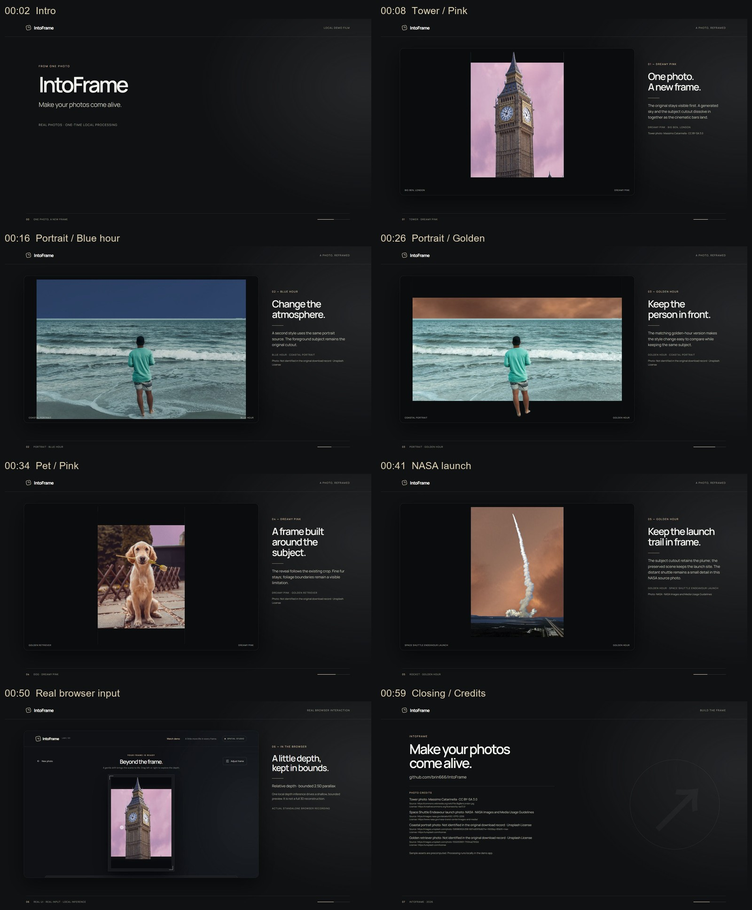

# IntoFrame

Turn ordinary photos into cinematic AI compositions. IntoFrame isolates the original subject, generates a new sky atmosphere with a local diffusion model, and places the subject over film bars. The optional hold animation uses one-shot relative depth, bounded local subject relief, and browser-side Three.js rendering.

## Run the submitted demo — no GPU setup required

```sh
git clone --branch demo/hackathon-submission https://github.com/brin666/IntoFrame.git
cd IntoFrame
npm ci
npm run dev
```

Open **http://127.0.0.1:5187/** and choose a real sample. The repository includes four precomputed examples, each with all three sky styles, original alpha and float32 depth. Samples, Before/After, the six-second transformation, spatial exploration and PNG download run from the included assets without backend requests. Uploading a new photo requires the local Python/CUDA backend below.

- **Complete demo film:** http://127.0.0.1:5187/demo.html — paused Remotion Player with play, scrub and MP4 download.
- **Submitted MP4:** [public/demo/IntoFrame-demo.mp4](public/demo/IntoFrame-demo.mp4).
- **Sample assets and limitations:** [DEMO_ASSETS](docs/DEMO_ASSETS.md).
- **Film storyboard and regeneration:** [DEMO_STORYBOARD](docs/DEMO_STORYBOARD.md).
- **Submission evidence and speaking notes:** [HACKATHON_DEMO](docs/HACKATHON_DEMO.md).

The film shows original-to-result transitions and an actual recording of the browser depth interaction. The generated skies are real saved local model outputs. Relative depth supports bounded nearby-view relief; it is not full 3D reconstruction or physical relighting.



An isolated [Subject Depth Mesh experiment](SUBJECT_DEPTH_EXPERIMENT.md) is available at
`/experiment.html`; it does not replace the production preview.

## What works now

- Upload JPG, PNG or WebP, up to 20 MB; the backend rejects unsupported or broken images.
- Run the official BiRefNet model locally on an NVIDIA GPU to obtain an alpha mask.
- Normalize EXIF orientation and resize source and mask into the same pixel coordinates.
- Render the original photo only inside the cinema aperture and its cut-out subject above the black bars.
- Adjust framing zoom, inspect the generated mask, retry with another photo.
- Report model and image failures without showing a fabricated result.
- After the static preview appears, estimate relative depth once with Depth Anything V2 Small, retain native float32 subject relief alongside the compatibility depth PNG, and conservatively fill the primary subject's hidden background.
- The **original upload** and generated **After** move gently once their current depth scene is ready. Press and drag left/right to take control; a stationary press freezes the view, and release softly resumes the automatic motion. Touch uses horizontal intent while vertical page scrolling stays available. Before comparison, mask inspection, generation and reduced-motion preference stay still. Missing or unreliable native depth leaves a clear static fallback.
- Choose Dreamy Pink, Golden Hour, or Cinematic Night. A local Stable Diffusion inpainting checkpoint generates a new sky field. The full-resolution original subject is restored using the BiRefNet alpha mask; no paid image API is called.
- Compare Before/After, watch generation status, and download a full-resolution PNG with the visible film bars and pop-out subject.
- A six-second Remotion Player transition now plays after Generate: original photo, styled background, closing film bars and foreground pop-out. Replay or skip it, then return to the existing depth preview. PNG stays centered. See [web transition](docs/REMOTION_WEB_REVEAL.md).

This is a runnable prototype for **open-sky compositions**, not a general scene editor or precise 3D reconstruction. Cinematic Night now uses a restrained blue-hour sky and a mild shared exposure/color curve for the subject and retained scene. This does not reconstruct illumination or remove the original daylight shadows. See the [visual acceptance report](docs/VISUAL_ACCEPTANCE.md) for historical results and failures, and [atmosphere update](docs/ATMOSPHERE_ADAPTATION.md) for the current palette changes.

The current automatic/drag contract and local demo path are recorded in [Local interaction finish](docs/LOCAL_INTERACTION_FINISH.md). [Depth motion repair](docs/DEPTH_MOTION_REPAIR.md) records the preceding native-mesh checkpoint, and [Sky Restyling regression](docs/SKY_REGRESSION.md) records its sky-generation checkpoint. Earlier astronaut/coffee examples remain historical checkpoints: those indoor photos are now rejected for sky generation. [Asset credits](docs/ASSET_CREDITS.md).

## Requirements

- Windows with Python 3.11, Node.js 20+, and an NVIDIA GPU with about 8 GB VRAM.
- Internet on the first run to download BiRefNet, Depth Anything V2 Small, SegFormer B0 sky segmentation, and Stable Diffusion v1.5 Inpainting weights from Hugging Face. Allow several GB of model cache and free RAM/disk space. Diffusion generation is serialized with other AI work to fit the 8 GB GPU.
- A modern desktop browser. All AI inference runs after upload, never per animation frame.

## Run locally

From the cloned project directory in PowerShell:

```powershell
git clone https://github.com/brin666/IntoFrame.git
cd IntoFrame
py -3.11 -m venv .venv
.\.venv\Scripts\python.exe -m pip install 'torch==2.11.0+cu128' 'torchvision==0.26.0+cu128' --index-url https://download.pytorch.org/whl/cu128
.\.venv\Scripts\python.exe -m pip install -r backend\requirements.txt
npm.cmd ci
```

Python 3.11 and Node must be on PATH. Open two terminals from the project directory:

```powershell
cd backend
..\.venv\Scripts\python.exe -m uvicorn main:app --host 127.0.0.1 --port 8000
```

```powershell
npm.cmd run dev
```

Open `http://127.0.0.1:5187`. The static preview appears as soon as segmentation completes; depth continues in the background. Choose a style and press **Generate background**. The first generation downloads the diffusion model; later generations are faster. Source images and results stay in `backend/data/` on this machine and are gitignored. Job records are in memory; restarting the API clears them. No API key or paid service is configured or required. The model weights are downloaded from Hugging Face, so the first run needs network access.

For a single-origin local demo, run `npm.cmd run build`, then `.\.venv\Scripts\python.exe scripts\serve-subject-experiment.py` from the project directory and open `http://127.0.0.1:5190/`. This helper also keeps `/experiment.html` accessible without changing the production preview. The existing experimental sample media are local-only: on another machine, prepare your own job as described in the [experiment guide](SUBJECT_DEPTH_EXPERIMENT.md).

## AI background generation and export

After segmentation, `POST /api/restyle` accepts `{"jobId":"<id>","style":"dreamy-pink"}`. Supported styles are `dreamy-pink`, `golden-hour`, and `cinematic-night`. Poll `GET /api/restyle/{id}/{style}` for `processing`, `complete`, or `failed`. A completed result includes native-size `backgroundUrl`, `compositeUrl`, and a reflected-overscan `renderBackgroundUrl` for the existing depth renderer. The endpoint reports errors rather than returning a substitute image.

A small pinned [SegFormer B0 ADE model](https://huggingface.co/nvidia/segformer-b0-finetuned-ade-512-512) analyzes sky on CPU once during upload. Its semantic editable-sky mask is independent of BiRefNet subject alpha. No-sky, ambiguous sky boundaries, or model-loading failures disable Generate with a reason; the API independently returns 422 without scheduling diffusion. The model has NVIDIA **noncommercial research/evaluation** terms, not MIT/Apache weight licensing. See [third-party terms](docs/THIRD_PARTY.md).

Native RGB and unchanged subject alpha refine local semantic sky omissions beside confirmed sky, with bounded reach, color agreement, connected paths and other-class barriers. Uploads retain raw semantic logits and the coarse mask for diagnosis (~8 MiB/job). This removes the large old-sky patches in the captured Big Ben case; large interior openings can still fail. Functional tests do not establish visual acceptance. See the [same-sky repair evidence and limits](docs/SKY_EDGE_REPAIR.md).

The existing SD1.5 Inpainting checkpoint synthesizes a separate sky texture at ~640 px with FP16 CPU offload and 22 steps. The generator receives a neutral field, not original roads/buildings to overwrite. Sky crop and grading remain. Semantic compositing replaces only permitted sky. Pink and Night apply the same pointwise RGB curve to the original subject and retained non-sky environment; Golden Hour retains original scene RGB. Alpha and scene geometry remain unchanged. Bounded Telea approximates pixels hidden by the primary subject, and sky coverage is extended only underneath that subject for disocclusion. Translucent ground contacts receive the same RGB treatment as their support scene.

Original uploads and generated After use a full indexed alpha mesh with shallow local relief, bounded to +/-0.36 virtual units around the subject's representative depth. Native float32 depth preserves relief that the scene-normalized 8-bit PNG can clip. In After, the subject and retained scene sample the same native depth surface so feet/support contacts move together; generated sky stays distant and flat at virtual z=-0.8. The subject mesh renders above the stationary bars. Perspective compensation and corrected screen UV interpolation reproduce the center-view photo without depth seams. Old photo depth is never applied to generated sky. This is shallow 2.5D relief, not accurate orthogonal walls or backside reconstruction; no AI runs per frame.

Maximum camera travel comes from desired CSS-pixel subject/background separation, viewport, zoom, alpha occupancy and representative depth: 4-6px on desktop and 2.8-4px for touch, before safety caps. Overscan and source-side cut contacts cap each direction using the nearest actual mesh depth. Automatic motion uses 35% of this safe range over a 16-second cycle; horizontal dragging can explore the full safe range. Camera Z stays fixed, so pressing does not introduce a zoom. Resize and zoom recalculate limits. Scene readiness and resource/lifecycle changes gate interaction; Before, mask inspection, generation, hidden/unfocused pages and reduced motion pause it. Missing, weak or invalid native depth and graphics context loss leave a static fallback. [Current contract and evidence](docs/LOCAL_INTERACTION_FINISH.md).

The browser PNG exporter uses the current zoom and composition offsets, clips the generated background to the middle 74%, draws equal top and bottom bars from the **same 13% parameter used by the DOM**, then draws the recovered transparent subject over them. It exports the **centered, still AI result** at the processed source resolution. Camera animation is not encoded. Download is disabled while inspecting Before or the mask to avoid confusing those views with the exported result. Browser and PNG have matching composition, with different raster sampling at fractional CSS sizes; pixel identity with a scaled screenshot is not claimed.

Completed restyle responses also include `subjectUrl`, `backgroundGeometry: "sky-layers"`, `renderSkyUrl`, `renderSceneUrl`, `editableSkyUrl`, `atmosphereVersion`, and metrics for seed, pinned model revision, prompts, steps, guidance, loading and inference seconds, edge processing and color treatment. New palettes use versioned media paths; outdated cached styles are regenerated through **Update atmosphere**. The same metadata are stored next to the local output as `metadata.json`; `model-sky-raw.png` retains the ungraded model output for inspection.

## Depth API and image coordinates

After `GET /api/jobs/{id}` completes, send `POST /api/depth` with JSON `{"jobId":"<id>"}`. Poll `GET /api/depth/{id}` until `status` is `complete` or `failed`. A completed result gives:

- `depthUrl`: native-size 8-bit grayscale PNG, white (255) nearer and black (0) farther. Values are robust percentile-normalized **relative** depth, not metres.
- `renderDepthUrl`: the same signal after subject-hole fill and reflected edge padding; `backgroundUrl`: the matching padded RGB WebP. `renderWidth`, `renderHeight`, and `padding` describe their coordinates.
- `foregroundDepth`: median compatibility depth within the alpha subject, used as the bounded representative depth for local relief.
- `meshDepthUrl` and `meshDepthMetadata`: native `subject-depth-f32.bin`, little-endian row-major float32, with dimensions, subject 5th/95th percentiles and median, global range statistics and model pin. These preserve unquantized model output; larger values mean nearer.
- `meshDepthDiagnostics`: relief eligibility and a reason for empty, flat or weak subject ranges. The raw asset is omitted when no opaque subject can be measured; clients keep the still fallback.

Source, mask, subject and native float32 depth share the same EXIF-corrected width and height. Both padded render assets share another exact width and height. The compatibility PNG and raw float32 asset come from a single inference per uploaded photo; no AI call runs during animation. Missing raw assets, unreliable relief, dimension/encoding/sample failures, or a lost graphics context leave the still composition visible with a clear message.

## Model and source credits

- [BiRefNet](https://github.com/ZhengPeng7/BiRefNet), official weights [`ZhengPeng7/BiRefNet`](https://huggingface.co/ZhengPeng7/BiRefNet), MIT per the code repository and model card. The model's remote Python implementation is loaded via `trust_remote_code=True` at pinned revision `e2bf8e4460fc8fa32bba5ea4d94b3233d367b0e4`.
- [Depth Anything V2 Small](https://huggingface.co/depth-anything/Depth-Anything-V2-Small-hf), Apache 2.0 for the Small checkpoint, loaded at pinned revision `5426e4f0f36572d16453bbda7a8389317b1bef99`. Larger checkpoints have different terms and are not selected here.
- [Stable Diffusion v1.5 Inpainting](https://huggingface.co/stable-diffusion-v1-5/stable-diffusion-inpainting), CreativeML OpenRAIL-M, loaded at pinned revision `8a4288a76071f7280aedbdb3253bdb9e9d5d84bb`. Review its license and use restrictions before publication; model output quality varies by image.
- [SegFormer B0 ADE](https://huggingface.co/nvidia/segformer-b0-finetuned-ade-512-512), pinned `489d5cd81a0b59fab9b7ea758d3548ebe99677da`; [NVIDIA Source Code License](https://github.com/NVlabs/SegFormer/blob/master/LICENSE) restricts this demo model to noncommercial research/evaluation.
- UI: React, Three.js and Vite (MIT), Lucide icons (ISC). Backend: FastAPI (MIT), Diffusers (Apache 2.0), Pillow 12.3 (MIT-CMU), OpenCV (Apache 2.0), and PyTorch (BSD-3-Clause). See [third-party credits](docs/THIRD_PARTY.md) for other direct dependencies and model pins.

No repository-wide license for project-authored code has been selected. Publishing the repository does not relicense third-party code, model weights, or sample images. Their separate terms and attributions remain applicable.

For Banana Hacks 2026, cite the models, libraries, and AI development tools (including OpenAI Codex used for implementation/testing) in the submission. The [public repository](https://github.com/brin666/IntoFrame) retains real commit timestamps and history. Public publication is **not** a contest-platform submission or proof of eligibility. Private building photos, model weights, logs and test caches are excluded; only explicitly credited public samples are distributed.

Failed background jobs can be submitted again with the same source and style. Processing requests share the existing task; completed requests reuse the saved result.

## Verification

Focused depth checks run without models or a running API:

```powershell
.\.venv\Scripts\python.exe scripts\test-depth-contract.py
node scripts\test-depth-geometry.mjs
```

The current frozen browser regression reuses cached source, depth and generated sky assets; it performs no inference or generation. Serve the app locally and provide the existing fixture manifest described in [Local interaction finish](docs/LOCAL_INTERACTION_FINISH.md):

```powershell
node scripts\test-scene-motion.mjs
node scripts\drag-motion-browser.mjs --base http://127.0.0.1:5190 --manifest screenshots/depth-motion-fix/manifest.json --out screenshots/drag-motion-fix/browser --include bigben,dog,paris
```

Desktop and phone-emulated results are browser evidence, not physical phone testing. The report distinguishes measured local relief, interaction/fallback checks and remaining visual limits.

For the broader upload/sky pipeline, with both local servers running:

```powershell
.\.venv\Scripts\python.exe scripts\prepare-sky-inputs.py
.\.venv\Scripts\python.exe scripts\smoke.py
node scripts\browser-smoke.mjs
.\.venv\Scripts\python.exe scripts\depth-smoke.py
node scripts\spatial-browser-smoke.mjs
node scripts\restyle-browser-smoke.mjs
.\.venv\Scripts\python.exe scripts\test-restyle-jobs.py
.\.venv\Scripts\python.exe scripts\test-compositing.py
.\.venv\Scripts\python.exe scripts\test-sky-detector.py --model-smoke
.\.venv\Scripts\python.exe scripts\test-sky-compositing.py
node scripts\test-parallax.mjs
node scripts\sky-browser-smoke.mjs
npm.cmd run build
```

The upload/depth scripts use scikit-image's `astronaut` (person), `chelsea` (cat), and `coffee` (object) sample images. Run the data smoke script first to create their source files. For the single-origin build, set `$env:INTOFRAME_URL='http://127.0.0.1:5190'` and `$env:INTOFRAME_API_URL='http://127.0.0.1:5190'`. Browser scripts require Google Chrome installed. For sky/restyle browser tests, provide an outdoor person via `INTOFRAME_PERSON_PHOTO` (parallax/sky tests) or `INTOFRAME_TEST_PHOTO` (restyle test). Default evaluation images are downloaded by `scripts/prepare-sky-inputs.py` into ignored local data. Indoor astronaut/cat/coffee remain valid upload/depth tests, but must reject sky editing. The restyle test performs real generation in all three styles, injects transport failures to check retry and texture recovery, and checks Before/After and PNG download. Model failure scheduling is separately unit-tested.

`spatial-browser-smoke.mjs` runs `parallax-browser-smoke.mjs`, the earlier generated-sky regression: real person generation on desktop and emulated mobile, projected subject-to-sky separation, release/cancel/leave/blur, static Before, reduced motion and identical PNG bytes during hold. Set `INTOFRAME_TEST_PHOTO` to your local building photo to add the Big Ben case to that gate (also usable by the restyle test). Evidence stays in ignored `screenshots/parallax/regression/`. Its historical two-plane motion results do not validate the repaired native mesh; three-category upload/depth checks remain useful separately. Measured 240 animation callbacks/s and a 4.3ms p95 interval in headless Chrome are callback timing, not display FPS.

For current automatic/drag evidence and a cached review launcher, use [Local interaction finish](docs/LOCAL_INTERACTION_FINISH.md). [Depth motion repair](docs/DEPTH_MOTION_REPAIR.md), [sky acceptance](docs/SKY_REGRESSION.md) and the [earlier acceptance report](docs/VISUAL_ACCEPTANCE.md) remain records of their respective checkpoints. The older hold harness expects static rest/release and is historical; its counts do not validate the new interaction. Visual judgments remain separate from automated checks.

## Current limits

BiRefNet emits one salient-object mask; ambiguous subjects may need a different photo. Sky segmentation is conservative and can reject real smooth sky that resembles a wall. It is not a universal scene editor. Native relief is a shallow 2.5D approximation: it cannot recover accurate perpendicular walls, unseen backsides or separately reconstructed objects. Shared subject/retained-scene geometry preserves contacts but does not prove physical reconstruction. Hidden scene fill remains approximate; short camera travel limits its exposure. The original subject is not relit, and fine segmentation edges can retain old sky color. Virtual depths are visual ranges, not metres. Camera motion cannot be both symmetric and cut-safe if the subject is cut by both source sides at zoom 1; the renderer reports this limit. Subject selection, brush edits, gyroscope and video export remain future work. Browser callback timings and phone emulation do not establish physical phone/display performance.
