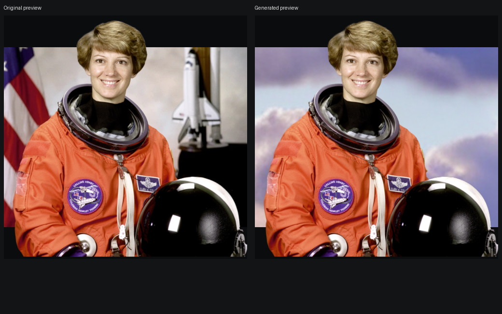

# IntoFrame

Turn ordinary photos into cinematic AI compositions. IntoFrame isolates the original subject, generates a new sky atmosphere with a local diffusion model, and places the subject over film bars. The optional hold animation uses one-shot relative depth and browser-side Three.js rendering.

An isolated [Subject Depth Mesh experiment](SUBJECT_DEPTH_EXPERIMENT.md) is available at
`/experiment.html`; it does not replace the production preview.

## What works now

- Upload JPG, PNG or WebP, up to 20 MB; the backend rejects unsupported or broken images.
- Run the official BiRefNet model locally on an NVIDIA GPU to obtain an alpha mask.
- Normalize EXIF orientation and resize source and mask into the same pixel coordinates.
- Render the original photo only inside the cinema aperture and its cut-out subject above the black bars.
- Adjust framing zoom, inspect the generated mask, retry with another photo.
- Report model and image failures without showing a fabricated result.
- After the static preview appears, estimate relative depth once with Depth Anything V2 Small, fill the primary subject's hidden background conservatively, and render a padded depth mesh in Three.js.
- Hold the generated **After** photo with a mouse or finger to wake a small camera sway; release or move outside to settle. Before, mask inspection and generation stay still. The transparent subject remains above the film bars. Reduced-motion preference leaves the photo still.
- Choose Dreamy Pink, Golden Hour, or Cinematic Night. A local Stable Diffusion inpainting checkpoint generates a new sky field. The full-resolution original subject is restored using the BiRefNet alpha mask; no paid image API is called.
- Compare Before/After, watch generation status, and download a full-resolution PNG with the visible film bars and pop-out subject.

This is a runnable prototype for **open-sky compositions**, not a general scene editor or precise 3D reconstruction. Night retains the subject's original lighting and is explicitly a stylized composite. See the [visual acceptance report](docs/VISUAL_ACCEPTANCE.md) for individual results and failures.



NASA/scikit-image sample; real locally generated background. [PNG export](docs/examples/astronaut-export.png). Source credit and rights are documented in [asset credits](docs/ASSET_CREDITS.md).

## Requirements

- Windows with Python 3.11, Node.js 20+, and an NVIDIA GPU with about 8 GB VRAM.
- Internet on the first run to download BiRefNet, Depth Anything V2 Small, and Stable Diffusion v1.5 Inpainting weights from Hugging Face. Allow several GB of model cache and free RAM/disk space. Diffusion generation is serialized with other AI work to fit the 8 GB GPU.
- A modern desktop browser. All AI inference runs after upload, never per animation frame.

## Run locally

From the cloned project directory in PowerShell:

```powershell
git clone https://github.com/brin666/IntoFrame.git
cd IntoFrame
py -3.11 -m venv .venv
.\.venv\Scripts\python.exe -m pip install 'torch==2.11.0+cu128' 'torchvision==0.26.0+cu128' --index-url https://download.pytorch.org/whl/cu128
.\.venv\Scripts\python.exe -m pip install -r backend\requirements.txt
npm.cmd ci
```

Python 3.11 and Node must be on PATH. Open two terminals from the project directory:

```powershell
cd backend
..\.venv\Scripts\python.exe -m uvicorn main:app --host 127.0.0.1 --port 8000
```

```powershell
npm.cmd run dev
```

Open `http://127.0.0.1:5187`. The static preview appears as soon as segmentation completes; depth continues in the background. Choose a style and press **Generate background**. The first generation downloads the diffusion model; later generations are faster. Source images and results stay in `backend/data/` on this machine and are gitignored. Job records are in memory; restarting the API clears them. No API key or paid service is configured or required. The model weights are downloaded from Hugging Face, so the first run needs network access.

For a single-origin local demo, run `npm.cmd run build`, then `.\.venv\Scripts\python.exe scripts\serve-subject-experiment.py` from the project directory and open `http://127.0.0.1:5190/`. This helper also keeps `/experiment.html` accessible without changing the production preview. The existing experimental sample media are local-only: on another machine, prepare your own job as described in the [experiment guide](SUBJECT_DEPTH_EXPERIMENT.md).

## AI background generation and export

After segmentation, `POST /api/restyle` accepts `{"jobId":"<id>","style":"dreamy-pink"}`. Supported styles are `dreamy-pink`, `golden-hour`, and `cinematic-night`. Poll `GET /api/restyle/{id}/{style}` for `processing`, `complete`, or `failed`. A completed result includes native-size `backgroundUrl`, `compositeUrl`, and a reflected-overscan `renderBackgroundUrl` for the existing depth renderer. The endpoint reports errors rather than returning a substitute image.

The local [Stable Diffusion v1.5 Inpainting checkpoint](https://huggingface.co/stable-diffusion-v1-5/stable-diffusion-inpainting) runs in FP16 at about 640 px on its longest side with CPU offload and 22 denoising steps. In this MVP it synthesizes a **whole background intended as sky**; the subject mask protects original pixels during the full-resolution composite. A deterministic crop selects the upper generated region. Golden Hour receives a warm grade and Cinematic Night a cool grade. These are real diffusion textures followed by conventional crop/color processing. The model can still invent an unwanted horizon, as seen in the coffee boundary test. This is **not** context-aware replacement of every original background object and does not relight the subject.

Source RGB and all styled background assets are saved losslessly. A bounded color recovery changes only semitransparent silhouette RGB within four pixels of clear background, with nearby opaque foreground as a reference; alpha is unchanged. Opaque subject cores are preserved. This does not correct opaque mask false positives, so some fine tower-tip spill remains. Original preview and experiment assets retain their existing foreground logic.

Original-photo motion uses the existing filled photo-depth mesh. Generated backgrounds use a distant plane with the **same perspective camera** and bounded hold/release motion; they do not inherit roads, room surfaces or buildings from the replaced scene's depth. Subject plane depth still comes from the original subject. No AI runs per frame.

The main preview enables hold only after the generated scene's own texture is ready. The original photo-depth implementation remains available, while Before is a still comparison. Full generated skies use the existing overscan camera bound without the original photo's mask-edge travel penalty. Render asset errors are separate from depth inference errors, so switching Before/After can retry a failed texture. See the [hold-parallax regression report](docs/PARALLAX_REGRESSION.md).

The browser PNG exporter uses the current zoom and composition offsets, clips the generated background to the middle 74%, draws equal top and bottom bars from the **same 13% parameter used by the DOM**, then draws the recovered transparent subject over them. It exports the **centered, still AI result** at the processed source resolution. Camera animation is not encoded. Download is disabled while inspecting Before or the mask to avoid confusing those views with the exported result. Browser and PNG have matching composition, with different raster sampling at fractional CSS sizes; pixel identity with a scaled screenshot is not claimed.

Completed restyle responses also include `subjectUrl`, `backgroundGeometry: "sky-plane"`, and metrics for seed, pinned model revision, prompts, steps, guidance, loading and inference seconds, and edge processing. The same metadata are stored next to the local output as `metadata.json`.

## Depth API and image coordinates

After `GET /api/jobs/{id}` completes, send `POST /api/depth` with JSON `{"jobId":"<id>"}`. Poll `GET /api/depth/{id}` until `status` is `complete` or `failed`. A completed result gives:

- `depthUrl`: native-size 8-bit grayscale PNG, white (255) nearer and black (0) farther. Values are robust percentile-normalized **relative** depth, not metres.
- `renderDepthUrl`: the same signal after subject-hole fill and reflected edge padding; `backgroundUrl`: the matching padded RGB WebP. `renderWidth`, `renderHeight`, and `padding` describe their coordinates.
- `foregroundDepth`: median native depth within the alpha subject, used to choose a bounded foreground projection plane.

Source, mask, subject and native depth share the same EXIF-corrected width and height. Both padded render assets share another exact width and height. These files are generated once per uploaded photo; no AI call runs during animation. Depth errors leave the static preview visible with a clear message.

## Model and source credits

- [BiRefNet](https://github.com/ZhengPeng7/BiRefNet), official weights [`ZhengPeng7/BiRefNet`](https://huggingface.co/ZhengPeng7/BiRefNet), MIT per the code repository and model card. The model's remote Python implementation is loaded via `trust_remote_code=True` at pinned revision `e2bf8e4460fc8fa32bba5ea4d94b3233d367b0e4`.
- [Depth Anything V2 Small](https://huggingface.co/depth-anything/Depth-Anything-V2-Small-hf), Apache 2.0 for the Small checkpoint, loaded at pinned revision `5426e4f0f36572d16453bbda7a8389317b1bef99`. Larger checkpoints have different terms and are not selected here.
- [Stable Diffusion v1.5 Inpainting](https://huggingface.co/stable-diffusion-v1-5/stable-diffusion-inpainting), CreativeML OpenRAIL-M, loaded at pinned revision `8a4288a76071f7280aedbdb3253bdb9e9d5d84bb`. Review its license and use restrictions before publication; model output quality varies by image.
- UI: React, Three.js and Vite (MIT), Lucide icons (ISC). Backend: FastAPI (MIT), Diffusers (Apache 2.0), Pillow 12.3 (MIT-CMU), OpenCV (Apache 2.0), and PyTorch (BSD-3-Clause). See [third-party credits](docs/THIRD_PARTY.md) for other direct dependencies and model pins.

No repository-wide license for project-authored code has been selected. Publishing the repository does not relicense third-party code, model weights, or sample images. Their separate terms and attributions remain applicable.

For Banana Hacks 2026, cite the models, libraries, and AI development tools (including OpenAI Codex used for implementation/testing) in the submission. The [public repository](https://github.com/brin666/IntoFrame) retains real commit timestamps and history. Public publication is **not** a contest-platform submission or proof of eligibility. Private building photos, model weights, logs and test caches are excluded; only explicitly credited public samples are distributed.

Failed background jobs can be submitted again with the same source and style. Processing requests share the existing task; completed requests reuse the saved result.

## Verification

With both local servers running:

```powershell
.\.venv\Scripts\python.exe scripts\smoke.py
node scripts\browser-smoke.mjs
.\.venv\Scripts\python.exe scripts\depth-smoke.py
node scripts\spatial-browser-smoke.mjs
node scripts\restyle-browser-smoke.mjs
.\.venv\Scripts\python.exe scripts\test-restyle-jobs.py
.\.venv\Scripts\python.exe scripts\test-compositing.py
npm.cmd run build
```

The upload/depth scripts use scikit-image's `astronaut` (person), `chelsea` (cat), and `coffee` (object) sample images. Run the data smoke script first to create their source files. For the single-origin build, set `$env:INTOFRAME_URL='http://127.0.0.1:5190'` and `$env:INTOFRAME_API_URL='http://127.0.0.1:5190'`. Browser scripts require Google Chrome installed. The restyle test performs real generation in all three styles, injects transport failures to check retry and texture recovery, and checks Before/After and PNG download. Model failure scheduling is separately unit-tested.

`spatial-browser-smoke.mjs` runs `parallax-browser-smoke.mjs`: real person generation on desktop and emulated mobile, projected subject-to-sky separation, release/cancel/leave/blur, static Before, reduced motion and identical PNG bytes during hold. Set `INTOFRAME_TEST_PHOTO` to your local building photo to add the Big Ben case to this gate (also usable by the restyle test). Evidence stays in ignored `screenshots/parallax/regression/`. The old pre-generation pet/object hold contract is replaced by generated-After acceptance; three-category upload/depth checks remain separate. Measured 240 animation callbacks/s and a 4.3 ms p95 interval in headless Chrome are **callback timing, not display FPS**.

For reproducible visual evidence, use the [acceptance procedure](docs/VISUAL_ACCEPTANCE.md). Original images, backgrounds, raw composites, exports, browser screenshots and enlarged edge comparisons are saved under ignored `screenshots/acceptance/`. Visual judgments are recorded separately from automated functional checks.

Example from a local Big Ben photo: the blue sky became pink clouds while the clock faces and tower remained intact; the exported PNG was 1426 × 1600 and retained the bars and tower tip. Dreamy Pink and Golden Hour were judged suitable for a normal-size prototype demonstration. Night was not recommended for the main showcase. The close-cropped cat and floating coffee examples are retained as limitations, rather than presented as universally successful compositions.

## Current limits

BiRefNet emits one salient-object mask. A distant subject, several overlapping subjects, or a busy scene can produce an unsuitable composition; the API rejects clearly empty or full masks. The crop uses a bounded subject-height heuristic and a manual zoom control. It cannot guarantee an attractive break on every image. The local SD1.5 model may invent an unwanted horizon or produce repetitive clouds; the sky crop and cool night grade are bounded fallbacks. Bright day-lit subjects against a night sky can look composited because the original subject RGB is deliberately preserved. Fine mask edges may retain a trace of the old sky color. OpenCV Telea still fills the hidden subject in the **original** depth background; the generated full-sky underlay already exists behind the subject. Depth is relative and may be wrong on reflective objects. Camera travel is clamped to reflected overscan. This is a 2.5D illusion, not a reconstructed 3D scene. Subject selection, brush mask editing, free drag exploration, mobile gyroscope and video export remain future work. Browser timing is measured in local headless Chrome and should be checked again on the presentation device.
