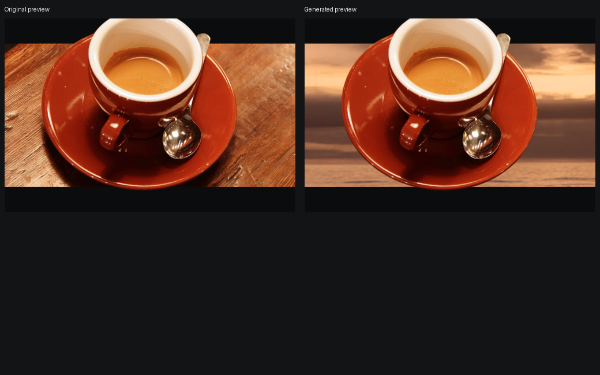

# Actual output acceptance — 2026-10-10

> Historical checkpoint before Sky Restyling First. Current behavior and acceptance are in [SKY_REGRESSION.md](SKY_REGRESSION.md); indoor astronaut, coffee and cat no longer generate sky.
Visual inspection was performed at ordinary browser preview size and on enlarged, identically cropped edge pairs. Functional test success is recorded separately from visual suitability. All six outputs below were produced by the actual local model and browser, not mockups.

## Current scope and recommended presentation

AI generates a whole background intended as sky; the original BiRefNet subject is composed above equal film bars. Original scene objects/layout are not preserved. Depth provides bounded 2.5D enhancement, not precise 3D reconstruction. Subject nighttime relighting is absent.

The two recommended local showcase effects are **Big Ben / Dreamy Pink** and **Big Ben / Golden Hour**. Both work at ordinary preview size, with fine mask spill still visible when enlarged. The building photograph's redistribution permission was not established, so none of its pixels or derivative images are in the public repository. Reproduce with your own authorized open-sky building image.

| Input / preset | Processed dimensions | Functional flow | Visual suitability | Remaining issues |
| --- | --- | --- | --- | --- |
| Local Big Ben / Dreamy Pink | 1426 × 1600 | Pass: generate, compare, export, pop-out | Suitable for prototype showcase at normal size | Some cyan/white spill remains in tower-tip mask false positives; clouds are soft after the upper-sky crop. |
| Local Big Ben / Golden Hour | 1426 × 1600 | Pass | Suitable for prototype showcase at normal size | Sky warmth is closer to the brickwork; cloud lighting and original building lighting are not physically recalibrated. Same fine mask limitations. |
| Local Big Ben / Cinematic Night | 1426 × 1600 | Pass | **Not recommended as main showcase** | Day-lit building against dark sky; enlarged stars and texture; stylized, not realistic night photography. |
| NASA astronaut / Dreamy Pink | 512 × 512 | Pass | Suitable as a clearly stylized person demo | Hair alpha edge remains slightly hard at enlargement; indoor source lighting is preserved. Not a real outdoor relocation. |
| Chelsea cat / Dreamy Pink | 451 × 300 | Pass | **Not recommended as main showcase** | The original cuts off the ears/head and fills the frame. The frame cannot invent missing fur; fine whiskers remain, with small edge/color artifacts. |
| Coffee on wooden table / Golden Hour | 600 × 400 | Pass | **Fails realistic scene relationship** | Table is replaced, cup floats against a generated landscape/horizon. The current sky-only scope cannot preserve support or room/table geometry. Failure retained. |

Public, licensed actual examples:


[Download the centered person PNG](examples/astronaut-export.png) · [hair edge recovery pair](examples/astronaut-edge-hair.png)



[Close-cropped cat comparison](examples/chelsea-before-after.png) · [source rights](ASSET_CREDITS.md)

## Generation parameters and timing

Source/output code: `cffdb09e60e46cc705a1fabaa8341b89cf697d4d`. This commit contains the image/render fixes; later changes retain the original conservative camera travel bound in sky mode and add test/documentation artifacts. Pixel generation and center-pose composition are unchanged by those follow-ups. Hardware: RTX 4060 Laptop, 8 GB VRAM. The model weights were already downloaded. "Cold" below means model initialization in a new backend process, **not** a fresh weight download.

All runs use `stable-diffusion-v1-5/stable-diffusion-inpainting` at revision `8a4288a76071f7280aedbdb3253bdb9e9d5d84bb`, FP16 with CPU offload, 22 steps, guidance 9, strength 1, an all-white edit mask, and upper-sky crop fraction 0.35. The prompts/negative prompts and exact metrics are saved in each local output's `metadata.json`; public sample measurements are also in [acceptance-metrics.json](examples/acceptance-metrics.json).

| Input / style | Model dimensions | Seed | Loading | Inference | Generation + sky processing |
| --- | --- | --- | --- | --- | --- |
| Big Ben / Pink | 576 × 640 | 1804180439 | 3.51 s, cold | 6.98 s | 10.69 s |
| Big Ben / Golden | 576 × 640 | 2996056356 | Already loaded | 4.18 s | 4.38 s |
| Big Ben / Night | 576 × 640 | 120833143 | Already loaded | 4.21 s | 4.43 s |
| Astronaut / Pink | 640 × 640 | 1181439702 | Already loaded | 3.89 s | 4.07 s |
| Chelsea / Pink | 640 × 448 | 590101538 | Already loaded | 3.95 s | 4.13 s |
| Coffee / Golden | 640 × 448 | 1775713519 | Already loaded | 3.95 s | 4.14 s |

Times above exclude subsequent edge recovery, asset encoding, HTTP polling, browser capture and export. User-visible waiting is longer. The first network download can take minutes. These measurements are not a cross-device speed guarantee.

The initial `before` captures use commit `18eb483` and the same input files. Changing lossy canonical WebP storage to lossless changes decoded RGB and thus the source-derived seed. Therefore cross-run skies are **not** used to prove an edge improvement. The enlarged edge pairs instead use **one frozen generated background, one source and one unchanged mask**, comparing old straight-alpha edge RGB with recovered edge RGB. There is no new AI draw or zoom change between the pair.

## Minimal fixes and what they actually change

1. Source, native sky and padded sky are lossless. Source RGB cannot drift between the segmentation layer and restyle composite. Padded central RGB is identical to the native generated background.
2. Edge recovery treats observed RGB as an uncertain foreground/background mixture, regularized by nearby opaque foreground. Only semitransparent pixels <=4 px from clear background and <=8 px from a reliable foreground reference are eligible. Per-channel changes are bounded to 48/255. No alpha erosion, whole-subject blur or whole-building recoloring is applied.
3. Generated sky uses a distant plane in the existing perspective-camera scene. It never samples the replaced room/table/road depths; original view keeps the photo depth mesh. Subject projection and bounded hold/settle motion remain.
4. One 13% bar-height constant drives both DOM bars/clipping and PNG clipping. Download states explicitly describe a **centered still**, and Before/mask inspection disable downloading that AI result.

All six outputs preserve alpha byte-for-byte; all opaque subject pixels remain unchanged. Modified RGB pixels: Big Ben 18,334, astronaut 2,613, cat 1,183, coffee 1,854. All are inside the permitted band. These numeric checks verify invariants, **not** beauty or perfect matting. Opaque mask false positives at the tower tip remain; subtle edge improvement is not claimed as a complete repair.

The PNGs were opened and compared to normal-size centered previews. Tower tip, clocks, crop position, background and bar boundaries correspond. Both bars have exactly the same measured DOM height (Big Ben 88.140625 CSS px). Export contains no controls, status overlays or debug content. Fractional CSS size capture and GPU/Canvas resampling cause nonzero raster differences: resizing the exported Big Ben PNG to the screenshot dimensions gives mean absolute RGB difference ~4.8/255, versus ~0.7 for the person. This is not claimed as pixel-identical output; visual composition was checked directly with a preview/export pair.

## Reproduce the evidence

Start the single-origin build as documented in [README](../README.md), then from the repository root:

```powershell
.\.venv\Scripts\python.exe scripts\prepare-acceptance-inputs.py
# Optional: add your own local building photo with --bigben <photo-path>.
$env:INTOFRAME_URL='http://127.0.0.1:5190'
$env:INTOFRAME_ACCEPTANCE_PHASE='after'
node scripts\visual-acceptance.mjs
.\.venv\Scripts\python.exe scripts\acceptance-artifacts.py after
```

Per input/style, ignored `screenshots/acceptance/after/` contains:

- `source.png`: processed, EXIF-corrected original (not the original full-size camera file).
- `background.png`: actual generated/cropped/graded background.
- `composite.png`: corrected subject/background, without bars.
- `export.png`: actual browser PNG download, with bars and pop-out.
- `browser.png`, `preview-before.png`, `preview-after.png`: real browser screenshots.
- `edge-*-compare.png`: enlarged frozen-background edge comparisons.
- `pipeline.png`, `before-after.png`, `preview-export.png`, `record.json`.

`manifest.json` records source identifiers/hashes, sizes, model/seed parameters, local output URLs, source commit and actual geometry. It stays local. Private images are never selected for public distribution by the preparation helper.

## Regression evidence

The original checks below describe the 2026-10-10 checkpoint. The current main interaction contract is **generated After only**; see the [2026-10-11 hold regression](PARALLAX_REGRESSION.md) for restored parallax, static Before, cancellation and PNG invariants.

Build (TypeScript + Vite), 3 restyle task scheduling/retry tests, and 4 compositing invariant tests passed. Three-category depth tests passed at source/render dimensions. Browser upload/zoom/mask tests, Before/After, real generation/PNG download, sky-plane selection and recovered foreground selection passed. Transport failure is injected only for frontend retry testing; subsequent success uses the real model, not a substituted image. GPU failures are not artificially induced.

Original spatial regression passed: camera moves on hold, settles to 0, foreground is above the bars, mobile touch works with zero horizontal overflow, and reduced-motion movement remains negligible. Headless Chrome measured 240 **animation callbacks/s**, p95 interval 4.3 ms. This is not display FPS. Three.js still produces a >500 kB chunk warning.

The existing `experiment.html` browser regression passed for Flat/Depth Left/Center/Right, debug mode, hold movement and settling to zero, with no page errors. It remains an isolated geometry lab with local-only float32 artifacts, not the main product or a promise of accurate building reconstruction. The test emitted 239.5 animation callbacks/s with p95 interval 4.3 ms, also not display FPS. Public repository publication preserves real history and does not constitute a contest-platform submission.

Known non-blocking warnings: the Three.js chunk exceeds 500 kB, and the mask-bound check uses Pillow's deprecated `getdata()` API (scheduled for removal in Pillow 14). Neither caused a failure in the tested pinned environment.
